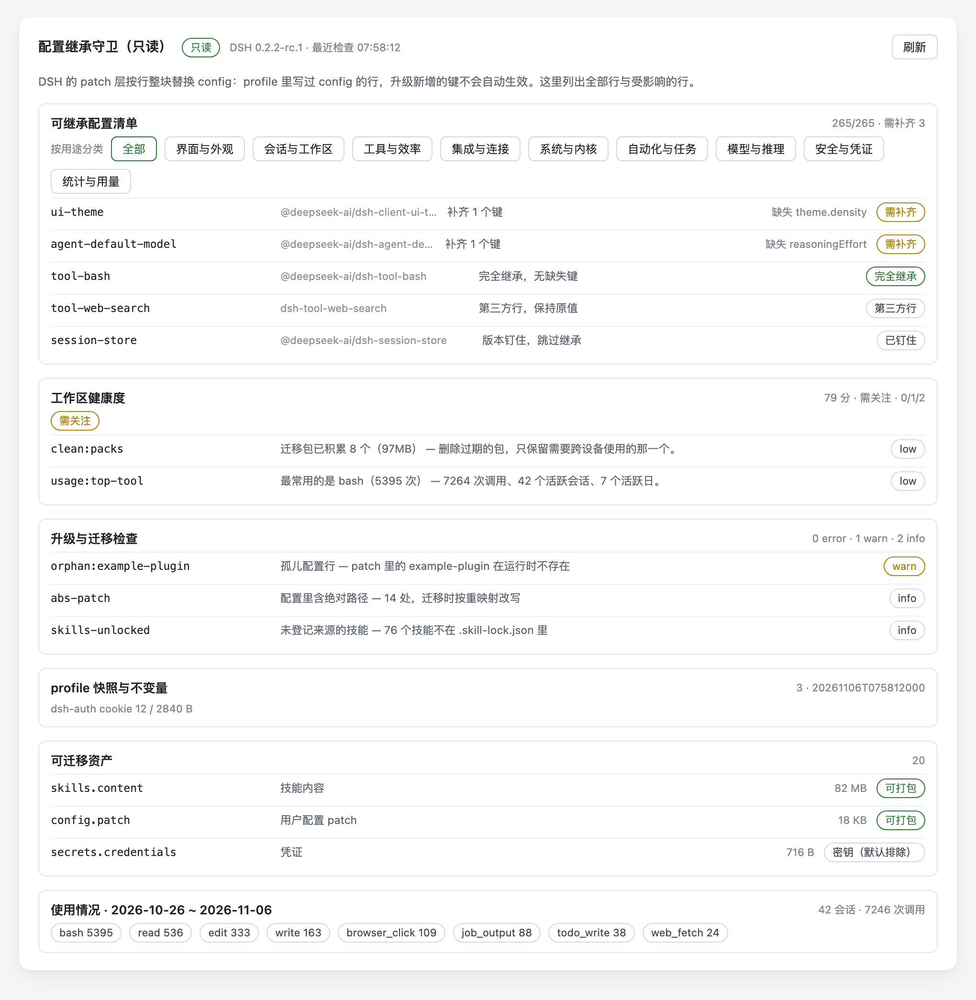

# dsh-config-guard (read-only report)

A settings-page plugin for DeepSeek Harness that makes configuration inheritance visible: which
rows your profile overrides, what an upgrade would silently drop, how big your workspace assets are,
and which tools you actually use.

**Read-only.** No configuration writes, no state file, no credential export, no network calls. It
only shows what the host already knows.



> The screenshot uses **sample data** (plugin ids, sizes and call counts are made up and
> sanitised), not anyone's real configuration.


## What it answers

- **Why did a new option not apply after an upgrade?** Rows are labelled
  `inherited / needs restore / pinned / third-party`, with the missing keys listed.
- **What would an upgrade drop?** The count of rows needing a restore, plus pinned dependencies and
  inactive bundles.
- **How big is my workspace?** 20 asset families with size and file counts, plus conflict findings
  (orphan config rows, dangling links, removed bundles, plaintext secrets).
- **Do I actually use this?** Tool-call counts aggregated by the host's own session activity cache —
  coverage window, sessions, top tools, models in use.
- **Is the workspace healthy?** A 0-100 score with advice-only suggestions.

## Install

```bash
git clone https://github.com/lixiaojie/dsh-config-guard.git
node dsh-config-guard/install.mjs --profile desktop
# restart DSH, then Settings → Config inheritance guard
```

`--uninstall` removes it again; `--dry-run` prints the plan without touching anything.

## What it reads / writes

Reads: `cordis.patch.yml`, the profile manifest, `ctx.configEditor.configuration()`, asset directories,
and the per-day tool-call counters in `~/.dsh/storages/session_projcache/sessions/*.json`
(no message bodies, no session replay).

Writes: nothing. There is no `writeFileSync` in the shipped code and an uninstall leaves no trace.

Network: none. The card only calls two same-origin GET endpoints.

## Endpoints

| Method | Path | Purpose |
|---|---|---|
| GET | `/config-guard/state` | Full snapshot: inventory, compatibility, assets, health, suggestions, usage |
| GET | `/config-guard/assets` | Assets only |

Anything non-GET returns `405`; unknown paths `404`; cross-origin requests `403`.

## Compatibility

It requires the `webServer`, `configEditor`, `pluginManager` and `appReady` services (0.2.1-rc.5+).
A host without them will not activate the plugin — this build does not half-load. Every call site is
still guarded: if a service exists but throws, the card degrades to what it could read and says so.
These services are not part of a documented public SDK yet — treat the version range in
`dsh.compatibility` as a declaration, not a guarantee.

## Licence

MIT
