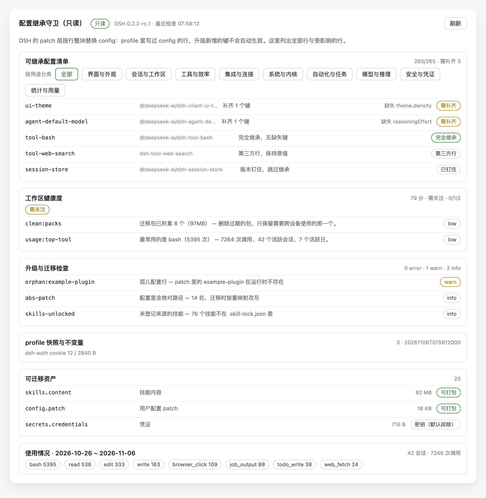

# dsh-config-guard（只读报告版）

一个 DSH 设置页插件：把「配置继承」讲清楚——profile 覆盖了哪些行、升级会悄悄丢掉什么、
工作区资产有多大、工具到底用得多不多。

**只读。** 不写配置、不落状态文件、不导出凭证、不发外部网络请求；只呈现宿主已经知道的东西。



> 截图使用**示例数据**（插件 id、体积、调用次数均为脱敏构造），不是任何人的真实配置。

## 它能回答什么

- **升级后新选项为什么没生效？** 每行标注 `完全继承 / 需补齐 / 已钉住 / 第三方行`，并列出缺失的键。
- **升级会丢掉什么？** 需要补齐的行数，加上版本钉住的依赖与未启用的 bundle。
- **工作区有多大？** 20 类资产的文件数与体积；冲突检查（孤儿配置行、失效 `link:`、
  已被移除的 bundle、明文密钥、未登记技能）。
- **这些工具我真的在用吗？** 用宿主自己的会话聚合缓存统计工具调用次数（覆盖窗口、会话数、
  高频工具、在用模型），不读消息正文。
- **工作区健不健康？** 0–100 分，建议只有文字，没有执行按钮。

## 安装

```sh
node install.mjs --profile desktop
# 重启 DSH，然后 设置 → 配置继承守卫
```

`--uninstall` 卸载，`--dry-run` 只打印计划。

## 读什么 / 写什么

读：`cordis.patch.yml`、profile 的 `package.json`、`ctx.configEditor.configuration()`、资产目录，
以及 `~/.dsh/storages/session_projcache/sessions/*.json` 里的按日工具计数（无消息正文、无会话回放）。

写：无。`lib/` 里没有 `writeFileSync` / `copyFileSync` / `rmSync`，没有 `configEditor.edit`，
卸载后不留痕迹。两个 GET 接口：`/config-guard/state`、`/config-guard/assets`；
其它方法一律 405，未知路径一律 404。

## 与完整版的区别

完整版（本仓库 `scripts/dsh-config-guard/`）可以逐项补齐、临时关闭、导出/导入迁移包。
本发布树只保留检查能力：没有写路径模块、没有状态文件、没有 UI 写入控件。
`test/readonly.test.js` 把这一点钉死：非 GET 请求被拒、一次完整读取不改动 profile 目录、
`lib/index.js` 出现写入符号或 `lib/pack.js` 出现即失败。

## 测试

```sh
node --test test/*.test.js   # 38 项
node test/smoke.mjs          # 只读冒烟：GET 通过、非 GET 被拒、profile 目录零新增
```

## profile 快照与不变量（v0.4 起）

完整版会滚动快照 profile 的 `package.json`（bundle 名单）、`cordis.patch.yml`、`preset-overrides.json`，
并与上一份对比，把「bundle 名单变短」「patch 体量骤降」「connection 行缺失 / cookie 寿命过长 /
cookie 罐接近 16 KiB 头限制」直接报成检查项。**本只读版不写快照**：它读完整版留下的快照做对比，
新装环境只有静态不变量检查；cookie 计数是对桌面端 `Cookies` 库的一次只读聚合查询，
打不开就标为不可用，不会抛错。

## 署名与许可

MIT · © 2026 xiaojieli · https://github.com/lixiaojie/dsh-config-guard

## 发布渠道

三个动作，顺序不能反：

1. **GitHub 仓库打 `dsh-plugin` topic**。`github.com/topics/dsh-plugin` 本身是发现页（当前 2.7 万+ 仓库），
   目录站的自动收集就是靠这个 topic 找到你；不打 topic，手动提交也能收录，但不会被自动发现。
2. **发布到 npm**（名字 `dsh-config-guard` 目前可用）。目录站只从 npm 安装，未发布的收录是「仅浏览」，
   详情页没有安装命令。
3. **向 [`imsai-sh/awesome-deepseek-harness-plugins`](https://github.com/imsai-sh/awesome-deepseek-harness-plugins)
   提一个只新增 `catalog/plugins/<owner>--<repo>.json` 的 PR**。静态审查只读仓库、
   校验 `package.json` 的 `dsh.bundle.patch` 和 patch 文件确实在树里（本仓库 `test/package.test.js` 提前镜像了这道检查），
   通过后自动 squash 合并，随后同步到 deepseek1024.com 与目录 README。
   条目模板见 `catalog/plugins.json.example`，分类取 `dev`（开发与运行时）。

`README.build.md` 记录了本发布树与完整版的差异。
